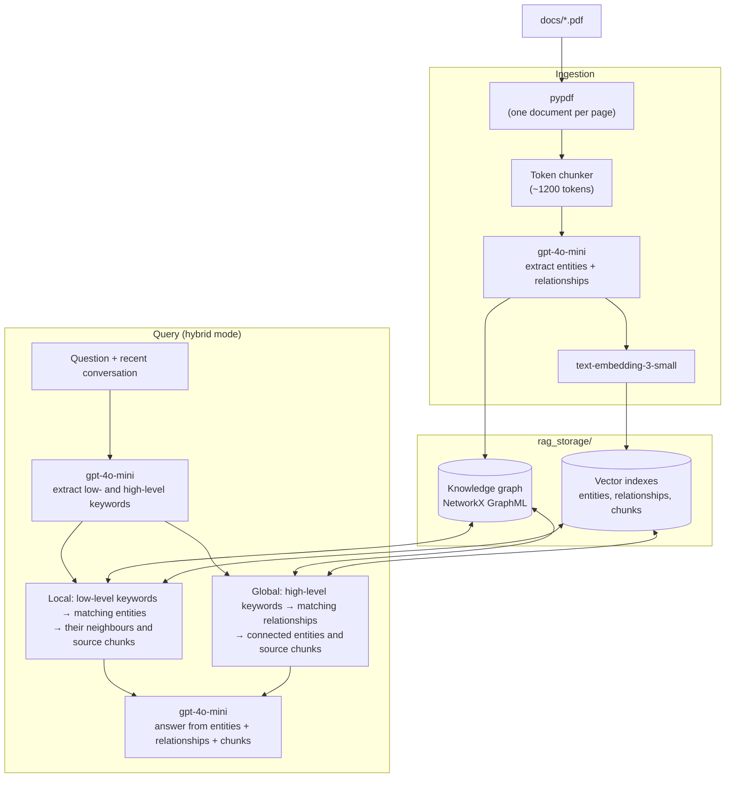

# PDF RAG with LightRAG (knowledge graph)

Graph-based retrieval-augmented generation over the PDF(s) in `docs/`, using
[LightRAG](https://github.com/HKUDS/LightRAG) (`lightrag-hku` 1.5.7).

Unlike the sibling vector-database services, LightRAG builds a **knowledge
graph** at ingest time: an LLM reads each chunk and extracts entities (people,
organisations, products, figures, ...) and the relationships between them.
Questions are answered from that graph plus the source text.

- **Chunking**: each PDF page is inserted as its own LightRAG document
  (`file_path` = `name.pdf#page=N`), then split into ~1200-token chunks. That
  keeps page numbers available for citations.
- **Entity and relationship extraction**: OpenAI `gpt-4o-mini`, one call per
  chunk.
- **Embeddings**: OpenAI `text-embedding-3-small` (1536 dims), for entities,
  relationships, and chunks.
- **Storage**: LightRAG's built-in file storage in `rag_storage/`: the graph as
  NetworkX GraphML, vector indexes in nano-vectordb, plus document status and
  an LLM cache. No database server needed.
- **Querying**: **hybrid** mode by default (see below), answered by `gpt-4o-mini`.

## Architecture



### Query modes

| Mode | Retrieves | Good for |
|---|---|---|
| `naive` | Chunks by vector similarity, no graph (like the vector-DB services) | Baseline comparison |
| `local` | Entities matching the question's specific terms, plus their neighbourhood in the graph | Specific facts about named things |
| `global` | Relationships matching the question's broader themes | Summaries, cross-cutting questions |
| **`hybrid`** (default) | `local` + `global` combined | General use; specific and thematic questions |
| `mix` | `hybrid` + `naive` chunk search | Maximum recall, larger prompts |

"Hybrid" here means LightRAG's entity-level + relationship-level graph
retrieval. It is not keyword + vector hybrid search (as in the Qdrant
service), although LightRAG does extract keywords from the question to drive
both halves.

## Setup

```bash
python3.12 -m venv .venv
source .venv/bin/activate
pip install -r requirements.txt
cp .env.example .env    # then fill in OPENAI_API_KEY
```

## Usage

```bash
# Build the knowledge graph from docs/*.pdf (or name files explicitly)
python cli.py ingest
python cli.py ingest docs/some-report.pdf

# Ask a question (hybrid by default; --mode naive|local|global|hybrid|mix)
python cli.py ask "How much did Apple spend on research and development?"

# Document counts by processing status
python cli.py status
```

Re-ingesting the same file skips pages that are already in the graph
(document ids are `name.pdf-pN`).

**Ingestion time and cost.** Every chunk needs an LLM extraction call, so
ingesting is much slower than for a vector database. The 80-page Apple 10-K
takes roughly 10–15 minutes with `LLM_MAX_ASYNC=8`, and well under $1 with
`gpt-4o-mini`. Extraction results are cached in `rag_storage/`, so
re-ingesting doesn't repeat them.

## Run as an API

```bash
uvicorn app.server:app --port 8002
```

- `GET /health` — liveness check.
- `POST /chat` — body `{"messages": [{"role": "user", "content": "..."}], "mode": "hybrid"}`
  (`mode` optional), returns
  `{"text": "...", "sources": [{"source": "...", "page": 20}, ...], "mode": "hybrid"}`.
  The last `user` message is the question; up to `HISTORY_TURNS` earlier
  messages are passed as conversation history, so follow-up questions work.
  `sources` are the pages of the chunks LightRAG used as context, in its
  ranking order.
- `POST /ingest` — multipart upload, field name `file` (PDF only, 25MB max).
  Saves the file into `docs/` and starts building the graph **in the
  background**. Returns immediately with
  `{"filename", "pages", "track_id", "status": "processing"}`.
- `GET /ingest/{track_id}` — progress of one upload:
  `{"track_id", "counts": {"processed": 34, "processing": 4, ...}, "done": false}`.
  Pages that were already in the graph are counted as `duplicate`.

```bash
curl -X POST http://localhost:8002/chat \
  -H "Content-Type: application/json" \
  -d '{"messages":[{"role":"user","content":"What are the main risk factors?"}]}'

curl -X POST http://localhost:8002/ingest -F "file=@docs/some-report.pdf"
curl http://localhost:8002/ingest/upload-1a2b3c4d5e6f
```

Set `CORS_ORIGINS` (comma-separated, default `http://localhost:3000`) to allow
the calling frontend's origin.

### Integration with my_test_chat_app

[my_test_chat_app](https://github.com/achyutasvm/my_test_chat_app) uses this
service for **Document Q&A → Knowledge graph**, alongside the Pinecone
([vector_embeddings](https://github.com/achyutasvm/vector_embeddings)) and
Qdrant ([langchain_qdrant_vectordb](https://github.com/achyutasvm/langchain_qdrant_vectordb))
vector-database services. Set `RAG_API_URL_LIGHTRAG=http://localhost:8002` in
that app's `.env.local`. Uploads made from the app while Knowledge graph is
selected come here, and the app polls `GET /ingest/{track_id}` to show
progress.

## Config

All settings are environment variables (see `.env.example`): `OPENAI_API_KEY`,
`LLM_MODEL`, `EMBEDDING_MODEL` / `EMBEDDING_DIM`, `WORKING_DIR`, `DOCS_DIR`,
`QUERY_MODE` (default `hybrid`), `HISTORY_TURNS`, `CHUNK_TOKEN_SIZE` /
`CHUNK_OVERLAP_TOKEN_SIZE`, `LLM_MAX_ASYNC`, and `CORS_ORIGINS`.

Changing `EMBEDDING_MODEL` or `EMBEDDING_DIM` after ingesting requires
deleting `rag_storage/` and ingesting again.

## Project structure

- `app/config.py` — environment-variable configuration.
- `app/ingest.py` — PDF loading (one document per page) and page-source helpers.
- `app/rag.py` — LightRAG setup (OpenAI LLM + embeddings, file storage),
  PDF insertion, ingest status, and querying.
- `app/server.py` — FastAPI app (`/health`, `/chat`, `/ingest`, `/ingest/{track_id}`).
- `cli.py` — CLI (`ingest`, `ask`, `status`).
- `docs/` — source PDFs (gitignored).
- `rag_storage/` — knowledge graph, vector indexes, caches (gitignored).
